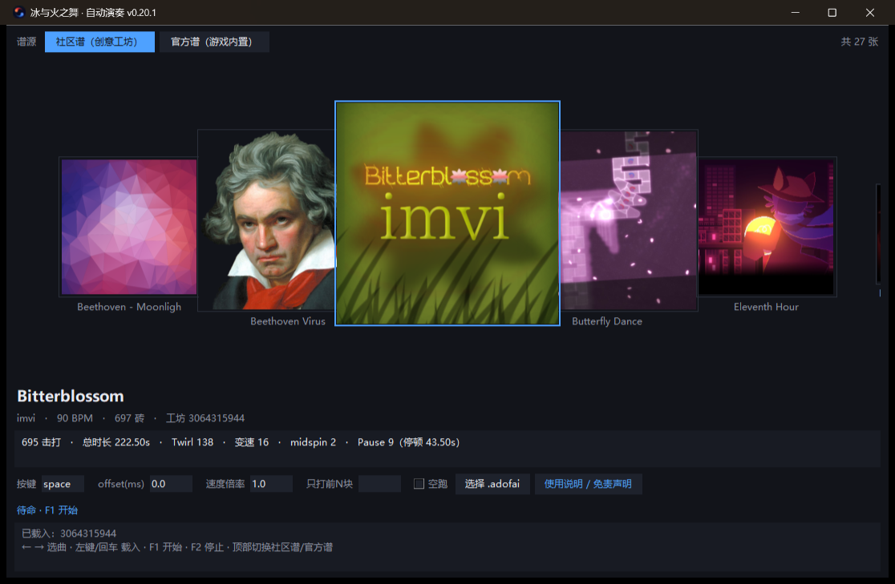

# 冰与火之舞 · 自动演奏（ADOFAI AutoPlay）

> 当前版本：**v0.10.1**（Windows）

读取创意工坊里的 `.adofai` 谱面，按时间轴把按键送进《冰与火之舞》，用来自娱自乐。
带横向封面选择器；只是模拟键盘，不读内存、不改游戏文件、不联网、不注入 DLL。



---

## 免责声明（请先读这段）

1. 本工具**仅供单人、离线、自娱自乐地观赏谱面**使用。
   请勿用于排行榜刷分、联机对战、比赛或任何形式的成绩提交。
2. 本工具与《冰与火之舞》的开发商 **7th Beat Games 无任何关系**，
   未经其授权或认可。游戏名称、图标等版权归其所有。
3. 使用本工具可能违反游戏的用户协议或社区规则，由此导致的
   存档异常、成绩失效、账号处罚等后果**由使用者自行承担**。
4. 本工具按"现状"提供，不附带任何明示或暗示的担保；作者不对使用
   本工具造成的任何直接或间接损失负责。
5. 若你不接受以上条款，请不要使用本程序。

程序内的「使用说明 / 免责声明」按钮里有同样的内容。

---

## 功能

- 横向封面选择器，左键 / 回车载入谱面
- 自动演奏创意工坊 `.adofai`：支持变速、长按、3-2-1 倒数、连按砖、三球等事件
- 高精度击打调度，实测抖动 < 1ms
- 全局热键 F1 开始 / F2 停止；窗口可缩放（最小 640×480）

## 环境要求

- Windows 10 / 11（依赖 `GetAsyncKeyState` / DWM）
- 已安装《冰与火之舞》，并在创意工坊里下载好想打的谱面
- 直接跑 exe 不需要 Python；从源码跑需要 Python 3.10+ 和 `pillow`

## 快速开始

1. 打开 `ADOFAI_AutoPlay.exe`。
2. 程序会自动找到
   `...\steamapps\workshop\content\977950\` 下的谱面。
   找不到就点「选择 .adofai」手动选一个 `main.adofai`。
3. `←` `→` 或滚轮选封面，居中那张就是当前的谱。
4. **左键点一下封面**（或回车）载入 —— 这时才会读谱、算时间轴。
5. 在游戏里选好**同一张谱**并进入关卡，等倒计时 / 加载结束。
6. 让游戏窗口保持前台，在**该按第一下的那一瞬间**按 `F1`（见下一节）。
7. 想停按 `F2`，或者把鼠标甩到屏幕左上角。

## 怎么开始演奏（重点）

> **核心规则：按下 `F1` 的那一瞬间，就是本工具发出的第一次击打。**
> 本工具不会等游戏里的音乐或行星，它把「你按 F1 的时刻」当作时间零点。

所以正确做法是：

1. 先点一下游戏窗口，确保它有焦点；鼠标不要放在屏幕左上角（那是急停区）。
2. 状态栏显示「待命 · F1 开始」才说明谱面已经载入好了。
3. 盯着游戏，等倒数结束、行星第一次落到第一块砖的那一刻 ——
   也就是「正常玩的时候该按第一下」的那一瞬间 —— 按下 `F1`。
4. **按一下就松手**，不要提前按住、也不要长按。之后窗口可以留在后台。

如果整首都偏早或偏晚，通常不是谱面算错了，而是 `F1` 按的时机不对：

| 现象 | 处理 |
|---|---|
| 整首提前 | 下次晚一点按 `F1`，或把 `offset(ms)` 调大 |
| 整首拖后 | 下次早一点按 `F1`，或把 `offset(ms)` 调小 |

想快速对齐：把「只打前N块」填 20，反复按 `F1` 试几秒，听判定是"太早"
还是"太晚"，比整首重跑省事得多。

「空跑」只跑调度、不真的发按键，用来看日志里的抖动统计，
**不能用来对齐游戏**（不会有任何按键进游戏）。

## 按键

| 操作 | 作用 |
|---|---|
| `←` / `→` | 上一张 / 下一张封面 |
| `Home` / `End` | 第一张 / 最后一张 |
| 鼠标滚轮 | 上下滚动切换 |
| 左键点封面 | 选中并**载入** |
| `回车` | 载入当前居中的封面 |
| `F1` | 开始演奏（全局热键） |
| `F2` | 停止（全局热键） |
| 鼠标移到左上角 | 急停 |

`F1`/`F2` 是全局物理按键检测，不需要本窗口有焦点；开始前让游戏窗口保持前台即可。
`F2` 由独立线程每 1ms 轮询一次，短按也能停下来；万一还是不灵，
把鼠标甩到屏幕左上角即可中止。停止后这一轮就结束了，想重跑要重新按 `F1`。

## 参数

| 参数 | 说明 |
|---|---|
| 按键 | 送进游戏的键，默认 `space`。游戏里也要用同一个键 |
| offset(ms) | 整条时间轴整体平移。全部偏晚填负数，偏早填正数 |
| 速度倍率 | 练习用：0.5 = 慢放一半（游戏里也要相应减速） |
| 只打前N块 | 只演奏前 N 次击打，用来快速验证某一段 |
| 空跑 | 只跑调度、不真的发按键，看日志里的抖动统计 |

## 常见问题

**整体都按早了 / 晚了？**
先用「只打前N块」跑 30 块，听节奏判断方向，再用 `offset(ms)` 微调：
偏晚填负数、偏早填正数，一般 ±30ms 内就够。

**F2 有时按了没反应？**
短按本来可能落在两次轮询之间，现在已改成独立线程每 1ms 轮询；
另外「鼠标甩到屏幕左上角」是同一优先级的急停，随时可用。

**按 F1 之后完全没反应？**
确认游戏窗口在前台、游戏用的是同一个键、并且已经**左键载入**过谱面
（状态栏应显示「待命 · F1 开始」）。

**某一段突然开始乱？**
多半是那段有特殊事件。载入时日志里会提示（比如 FreeRoam 需要方向键走位，
脚本过不去）。可以先用「只打前N块」二分定位。

**照着自己的谱面时间对不上？**
`python verify_timing.py` 会把游戏 `CalculateFloorEntryTimes` 的算法
逐砖跑一遍，跟本工具的时间轴对比，用来判断是"算错了"还是"操作问题"。

## 从源码运行

```bash
pip install pillow
python app.py
```

## 打包 exe

```bat
build_exe.bat
```

等价于：

```bat
python make_icon.py            :: 从游戏 exe 抽出图标到 assets/（只需一次）
python -m PyInstaller --noconsole --onefile --clean --name ADOFAI_AutoPlay ^
  --icon assets\icon.ico --add-data "assets;assets" app.py
```

产物在 `dist\ADOFAI_AutoPlay.exe`，`config.json` 会放在 exe 旁边记住上次的谱。

## 目录结构

```
app.py            GUI（封面流、参数、热键循环）
parse.py          .adofai 容错解析（BOM / 尾逗号 / 未转义换行 / 注释）
timeline.py       谱面 -> 击打时间轴（变速、长按、停顿、多球、连按…）
player.py         高精度调度 + 按键注入
input_win.py      Win32 扫描码注入与全局按键检测
verify_timing.py  与游戏算法逐砖对照，排查时序问题
make_icon.py      从游戏 exe 提取图标
audio_probe.py    音频对齐调试（开发用）
docs/             截图
```

## 已知限制

- 含 **FreeRoam（自由移动）** 的段落需要方向键走位，脚本无法通过，载入时会提示
- **官方内置谱面**（不是创意工坊谱）暂不支持
- 极端谱面下的长按松手、3-2-1 倒数段可能需要微调 `offset`

## 版权

- 程序图标来自《冰与火之舞》，版权归 **7th Beat Games** 所有，仅作识别用途。
- 谱面与音乐版权归各自作者所有，本仓库不包含任何谱面或音频。
- 本仓库代码可自由参考学习；因使用产生的任何后果与作者无关。
